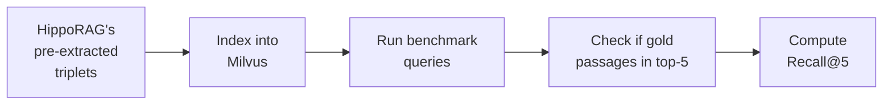
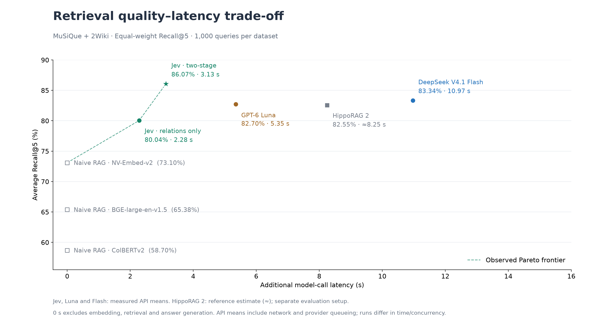

# Evaluation

Vector Graph RAG is evaluated on three standard multi-hop QA benchmarks used in the HippoRAG papers.

## Datasets

| Dataset | Description | Hop Count | Source |
|---------|-------------|-----------|--------|
| **MuSiQue** | Multi-hop questions requiring 2–4 reasoning steps | 2–4 hops | [Paper](https://arxiv.org/abs/2108.00573) |
| **HotpotQA** | Wikipedia-based multi-hop QA | 2 hops | [Paper](https://arxiv.org/abs/1809.09600) |
| **2WikiMultiHopQA** | Cross-document reasoning over Wikipedia | 2 hops | [Paper](https://arxiv.org/abs/2011.01060) |

**Recall@5** measures how much of the ground-truth supporting evidence appears in the top five retrieved results, independently of answer generation.

---

## Historical Results

These are the original three-dataset results, published before Jev was introduced into the project in September 2026.[^hotpot-sampling] The [latest two-stage Jev evaluation](#jev-reranker-evaluation) builds on this work with higher recall on MuSiQue and 2Wiki.

### Recall@5 vs. Naive RAG


| Method | MuSiQue | HotpotQA | 2WikiMultiHopQA | Average |
|--------|---------|----------|-----------------|---------|
| Naive RAG | 55.6% | 90.8% | 73.7% | 73.4% |
| **Vector Graph RAG** | **73.0%** | **96.3%** | **94.1%** | **87.8%** |
| Improvement | +31.4% | +6.1% | +27.7% | +19.6% |

Vector Graph RAG improves over Naive RAG by **19.6% in relative average Recall@5**, with the largest gains on MuSiQue and 2WikiMultiHopQA.

### Comparison with State-of-the-Art


| Method | MuSiQue | HotpotQA | 2WikiMultiHopQA | Average |
|--------|---------|----------|-----------------|---------|
| HippoRAG (ColBERTv2)[^1] | 51.9% | 77.7% | 89.1% | 72.9% |
| IRCoT + HippoRAG[^1] | 57.6% | 83.0% | 93.9% | 78.2% |
| NV-Embed-v2[^2] | 69.7% | 94.5% | 76.5% | 80.2% |
| HippoRAG 2[^2] | **74.7%** | **96.3%** | 90.4% | 87.1% |
| **Vector Graph RAG** | 73.0% | **96.3%** | **94.1%** | **87.8%** |

[^1]: [HippoRAG: Neurobiologically Inspired Long-Term Memory for LLMs (NeurIPS 2024)](https://arxiv.org/abs/2405.14831)
[^2]: [From RAG to Memory: Non-Parametric Continual Learning for LLMs (2025)](https://arxiv.org/abs/2502.14802)

The historical evaluation reached **87.8% average Recall@5**, leading on 2Wiki while trailing HippoRAG 2 on MuSiQue. **Two-stage Jev now improves both: 76.78% on MuSiQue and 95.35% on 2Wiki**, ahead of the compared baselines on each dataset. See the [Jev results below](#jev-reranker-evaluation) for the full comparison.

---

## Methodology

We reuse HippoRAG’s pre-extracted triplets to keep the graph input consistent across these experiments. Retrieval and reranking configurations are described in the corresponding results.

### Evaluation Setup



1. **Triplets**: Use HippoRAG's pre-extracted `(subject, predicate, object)` triplets from each benchmark dataset
2. **Indexing**: Build the vector knowledge graph in Milvus using these triplets
3. **Querying**: Run all benchmark questions through the query pipeline
4. **Scoring**: Check whether the ground-truth supporting passages appear in the top-5 retrieved results

---

## Reproduction

Full reproduction steps are available in the evaluation directory:

```bash
# Clone the repository
git clone https://github.com/zilliztech/vector-graph-rag.git
cd vector-graph-rag

# See evaluation instructions
cat evaluation/README.md
```

See [`evaluation/README.md`](https://github.com/zilliztech/vector-graph-rag/blob/main/evaluation/README.md) for detailed instructions.

## Jev Reranker Evaluation

We began evaluating Jev in September 2026, following its availability, and expanded to the full two-stage evaluation below in October 2026.

### Reaching the quality–latency Pareto frontier

**Two-stage Jev achieves the highest Recall@5 among the compared methods on both datasets**, averaging **86.07%** across **MuSiQue and 2Wiki, 1,000 questions each**. Using the displayed timings, it reaches the quality–latency Pareto frontier with **3.13 seconds of additional model-call time**.

The pipeline first selects relations, then reranks their source passages together with direct vector-search candidates. The second stage judges full passages, so the final ordering can use evidence beyond the relation text. It is a separate recipe and dataset scope from the historical three-dataset average above.

| Method | MuSiQue R@5 | 2Wiki R@5 | Average R@5 | Mean model-call time |
|---|---:|---:|---:|---:|
| Naive RAG · BGE-large-en-v1.5 | 58.03% | 72.73% | 65.38% | 0 s |
| Naive RAG · ColBERTv2 | 49.20% | 68.20% | 58.70% | 0 s |
| Naive RAG · NV-Embed-v2 | 69.70% | 76.50% | 73.10% | 0 s |
| HippoRAG 2 | 74.70% | 90.40% | 82.55% | ≈8.25 s (reference) |
| Vector Graph RAG + GPT-6 Luna | 72.18% | 93.23% | 82.70% | 5.35 s |
| Vector Graph RAG + DeepSeek V4.1 Flash | 73.20% | 93.48% | 83.34% | 10.97 s |
| Vector Graph RAG + Jev · relations only | 69.30% | 90.78% | 80.04% | 2.28 s |
| **Vector Graph RAG + Jev · two-stage** | **76.78%** | **95.35%** | **86.07%** | **3.13 s** |



Compared with relation-only Jev, the second stage adds **6.03 percentage points of average Recall@5** for about **0.85 seconds** more model-call time. It also improves average recall by **2.73 points over Vector Graph RAG + DeepSeek V4.1 Flash** and **3.52 points over HippoRAG 2**.

On the plotted Pareto frontier, no alternative offers both at least the same recall and no more additional model-call time, with a strict improvement in either. Two-stage Jev is the frontier's highest-quality option; direct retrieval and relation-only Jev offer lower-latency choices at lower recall.

The horizontal axis excludes embedding, retrieval and answer generation. Jev, Luna and Flash use measured API means; HippoRAG 2 retains a reference estimate. Test dates, concurrency and provider conditions differ, so the frontier is descriptive rather than a controlled end-to-end speed claim. Naive RAG adds no judgment call, hence zero additional time.

Luna uses **medium** reasoning: xhigh had similar recall (82.53% versus 82.70%) but higher mean latency (8.86 s versus 5.35 s); Flash uses **low** because high produced very long reasoning and exhausted the output limit on some questions.

See the [current evaluation report](../evaluation/jev/current/README.md) for the Flash audit and chart reproduction, and the [Jev recipe and score reproduction](../evaluation/jev/two-stage/README.md). Enable the implementation through the [reranking guide](guides/reranking.md).

[^hotpot-sampling]: The HippoRAG authors resampled HotpotQA between HippoRAG and HippoRAG 2, so the historical HotpotQA results use different question samples. The original three-dataset results are retained for reference. This does not affect the new Jev comparison, which uses MuSiQue and 2Wiki only.
